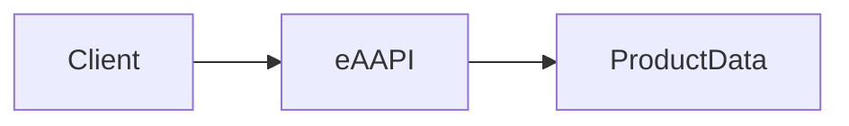
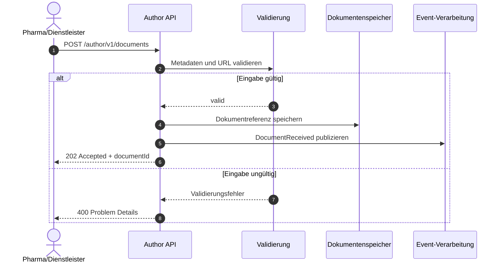
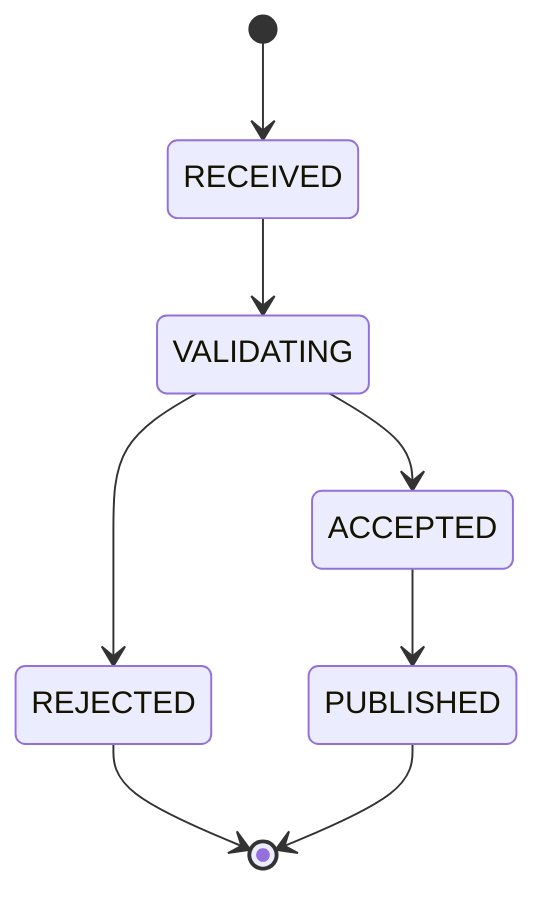

# eAAPI

Electronic Author API für die Pflege und Bereitstellung von Produktinformationen.

## Dokumentation

- [Version 1](v1/)
- [Release Notes](release-notes/)

## Überblick

Die eAAPI dient der Verwaltung und Bereitstellung von Produktinformationen innerhalb der RL-Digital-Plattform.

## Architektur

# Einlieferungsprozess

## Statusmodell

