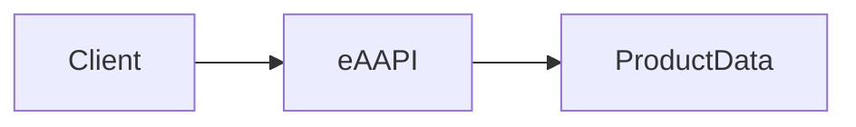
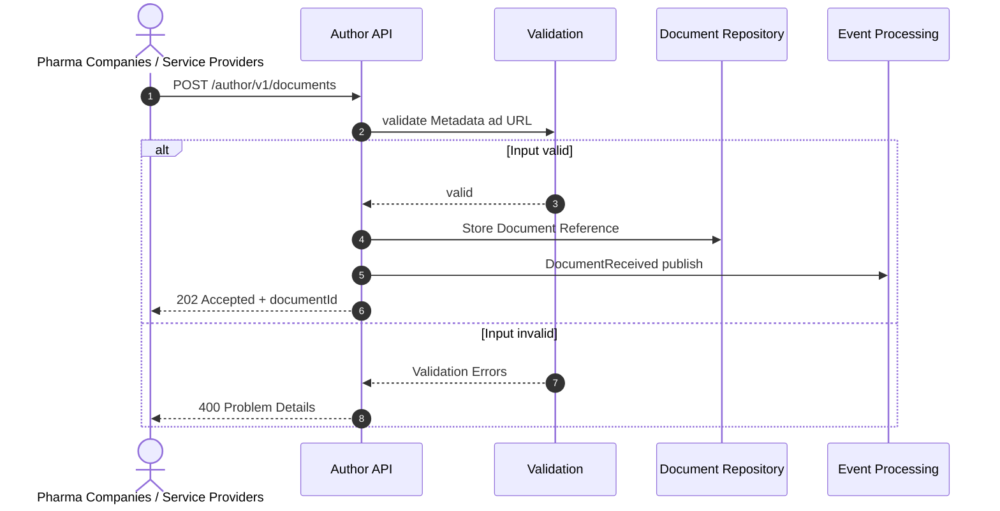
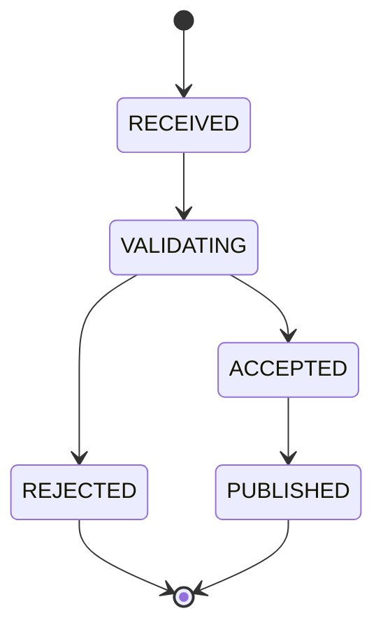

# eAAPI

Electronic Author API for managing product information.

## Dokumentation

- [Version 1](v1/)
- [Usage Example](example/)
- [Release Notes](release-notes/)

## Overview

The Electronic Author API (eAAPI) enables the creation, maintenance, and publication of product information within the EPL platform.

## Architectur

# Product Information Submission Process

The Product Information Submission Process describes how pharmaceutical companies and service providers submit product information to the EPL platform through the eAAPI. Submitted metadata and document references are validated, stored in the document repository, and processed asynchronously for publication. Invalid submissions are rejected with detailed validation errors, while valid submissions are accepted and processed through the platform's event-driven architecture.

## Status Model
The Status Model describes the lifecycle of a product information document within the EPL platform. After submission through the eAAPI, each document passes through validation and processing stages before either being rejected due to validation issues or successfully published and made available for consumption.

### RECEIVED

The document has been successfully submitted to the eAAPI and accepted for processing. At this stage, the platform has received the document metadata and associated document reference.

### VALIDATING

The platform validates the submitted information to ensure that all required metadata, document references, and business rules are fulfilled. During this phase, technical and functional validation checks are performed.

### ACCEPTED

The validation process has been completed successfully. The document has been approved for further processing and publication within the EPL platform.

### PUBLISHED

The document has been published successfully and is available for retrieval through the appropriate EPL consumer interfaces and services.

### REJECTED

The validation process has failed due to invalid or incomplete information. The document cannot be processed further until the identified validation issues have been corrected and the document has been resubmitted.