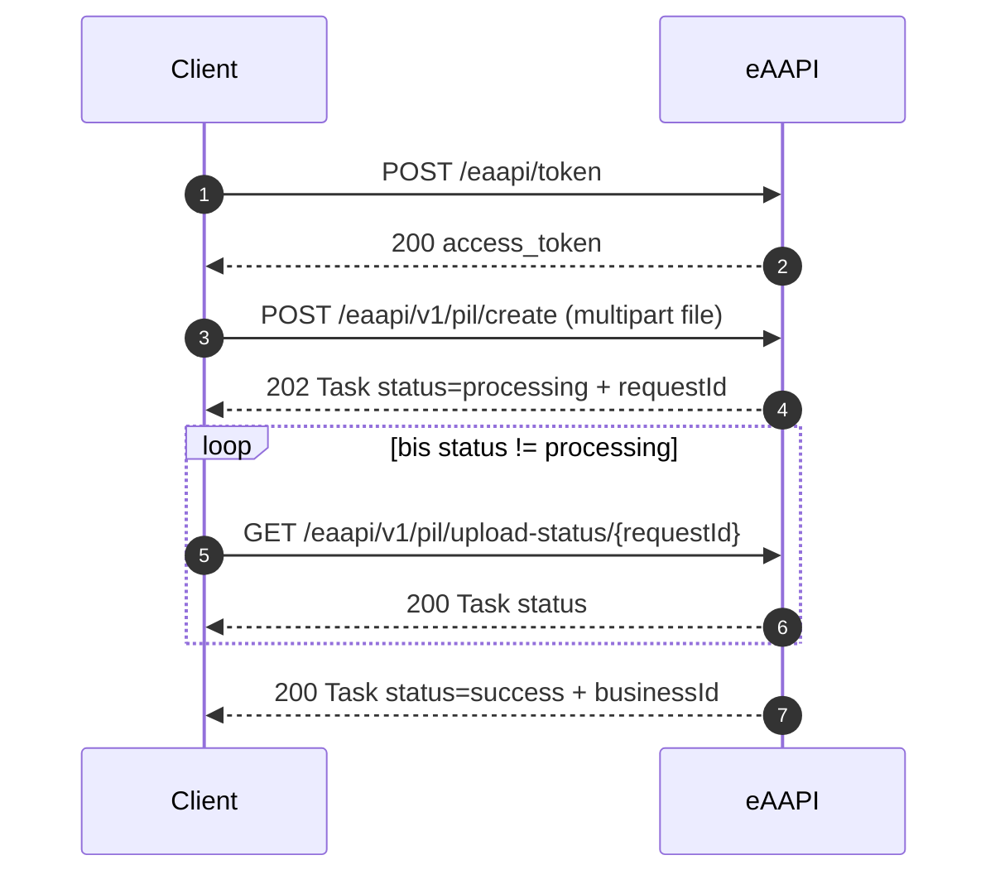

Dieser Ablauf zeigt eine vollständig erfolgreiche Einlieferung eines ePIL über die eAAPI v1:
Token anfordern, ePIL hochladen, Status abfragen und das Ergebnis auswerten.

Die vollständige Endpunkt- und Schemabeschreibung steht in der [OpenAPI-Dokumentation](../v1/).

## Voraussetzungen

| Wert | Beschreibung |
| --- | --- |
| `BASE_URL` | Basis-URL der Umgebung, z. B. `https://qa-digital.systems-tooling.de` |
| `CLIENT_ID` / `CLIENT_SECRET` | OAuth2-Client-Credentials des einliefernden Mandanten |
| ePIL-Datei | FHIR-Bundle gemäß [ePIL FHIR Implementation Guide](https://fhir.pharmaprotect.de/digital/epil-fhir-ig/) |

```bash
export BASE_URL="https://qa-digital.systems-tooling.de"
export CLIENT_ID="<client_id>"
export CLIENT_SECRET="<client_secret>"
```

{}
Client-Secrets gehören in eine Secret-Verwaltung und niemals in Repositories, Tickets oder Logs.
{}

## Schritt 1: Access Token anfordern

```bash
curl -X POST "$BASE_URL/eaapi/token" \
  -H "Content-Type: application/json" \
  -d "{
        \"grant_type\": \"client_credentials\",
        \"client_id\": \"$CLIENT_ID\",
        \"client_secret\": \"$CLIENT_SECRET\"
      }"
```

Antwort (`200 OK`):

```json
{
  "token_type": "Bearer",
  "expires_in": 3600,
  "access_token": "eyJ0eXAiOiJKV1QiLCJhbGciOiJSUzI1NiJ9..."
}
```

Token für die folgenden Aufrufe übernehmen:

```bash
export TOKEN="eyJ0eXAiOiJKV1QiLCJhbGciOiJSUzI1NiJ9..."
```

## Schritt 2: ePIL hochladen

Der Upload erfolgt als `multipart/form-data` mit dem Feld `file`.

```bash
curl -X POST "$BASE_URL/eaapi/v1/pil/create" \
  -H "Authorization: Bearer $TOKEN" \
  -F "file=@epil-bundle.json"
```

Antwort (`202 Accepted`):

```json
{
  "_id": {
    "id": "9fba01ee-171e-cca1-040f-ab17b4167a19"
  },
  "status": "processing",
  "intent": "order",
  "focus": {
    "reference": "DocumentReference/9fba01ee-171e-cca1-040f-ab17b4167a19"
  },
  "resourceType": "Task"
}
```

`_id.id` ist die `requestId` und wird für die Statusabfrage benötigt:

```bash
export REQUEST_ID="9fba01ee-171e-cca1-040f-ab17b4167a19"
```

## Schritt 3: Verarbeitungsstatus abfragen

Die Verarbeitung läuft asynchron. Der Status wird so lange abgefragt, bis `status` nicht mehr
`processing` ist.

```bash
curl "$BASE_URL/eaapi/v1/pil/upload-status/$REQUEST_ID" \
  -H "Authorization: Bearer $TOKEN"
```

Antwort (`200 OK`) nach erfolgreicher Verarbeitung:

```json
{
  "_id": {
    "id": "9fba01ee-171e-cca1-040f-ab17b4167a19"
  },
  "status": "success",
  "intent": "order",
  "focus": {
    "reference": "DocumentReference/9fba01ee-171e-cca1-040f-ab17b4167a19"
  },
  "output": [
    {
      "type": { "text": "businessId" },
      "valueCoding": {
        "system": "http://pharmaprotect.de/digital/epil",
        "code": "8a3f6502-db6e-5afb-b701-54395df701d9"
      }
    },
    {
      "type": { "text": "medicinalProductId" },
      "valueCoding": {
        "system": "http://pharmaprotect.de/digital/epil/medicinal-product-definition",
        "code": "f29661b7-672d-588b-874d-bf1b228d6127"
      }
    }
  ],
  "resourceType": "Task"
}
```

{}
Auch Verarbeitungsfehler werden mit HTTP `200` zurückgegeben. Der Erfolg ergibt sich ausschließlich
aus `status == "success"`, nicht aus dem HTTP-Statuscode.
{}

## Schritt 4: Ergebnis auswerten

| Feld | Bedeutung |
| --- | --- |
| `status` | `success` bestätigt die erfolgreiche Einlieferung |
| `output[].type.text == "businessId"` | Fachliche ID des ePIL, u. a. für das Sperren erforderlich |
| `output[].type.text == "medicinalProductId"` | IDs der erzeugten bzw. verknüpften Arzneimittel |

`businessId` extrahieren:

```bash
curl -s "$BASE_URL/eaapi/v1/pil/upload-status/$REQUEST_ID" \
  -H "Authorization: Bearer $TOKEN" \
  | jq -r '.output[] | select(.type.text == "businessId") | .valueCoding.code'
```

## Vollständiges Beispielskript

```bash
#!/usr/bin/env bash
set -euo pipefail

TOKEN=$(curl -s -X POST "$BASE_URL/eaapi/token" \
  -H "Content-Type: application/json" \
  -d "{\"grant_type\":\"client_credentials\",\"client_id\":\"$CLIENT_ID\",\"client_secret\":\"$CLIENT_SECRET\"}" \
  | jq -r '.access_token')

REQUEST_ID=$(curl -s -X POST "$BASE_URL/eaapi/v1/pil/create" \
  -H "Authorization: Bearer $TOKEN" \
  -F "file=@epil-bundle.json" \
  | jq -r '._id.id')

STATUS="processing"
while [ "$STATUS" = "processing" ]; do
  sleep 5
  RESPONSE=$(curl -s "$BASE_URL/eaapi/v1/pil/upload-status/$REQUEST_ID" \
    -H "Authorization: Bearer $TOKEN")
  STATUS=$(echo "$RESPONSE" | jq -r '.status')
done

if [ "$STATUS" != "success" ]; then
  echo "Einlieferung fehlgeschlagen: $(echo "$RESPONSE" | jq -r '.statusReason.concept.text // "unbekannt"')" >&2
  exit 1
fi

echo "$RESPONSE" | jq -r '.output[] | select(.type.text == "businessId") | .valueCoding.code'
```

## Ablauf im Überblick



## Alternative: Synchroner Upload

Für freigeschaltete Clients liefert `POST /eaapi/v1/pil/create-sync` dasselbe Ergebnis ohne Polling
direkt mit HTTP `200`. Auch hier ist `status == "success"` auszuwerten.

```bash
curl -X POST "$BASE_URL/eaapi/v1/pil/create-sync" \
  -H "Authorization: Bearer $TOKEN" \
  -F "file=@epil-bundle.json"
```

## Fehlerbehandlung

| Situation | Erkennung |
| --- | --- |
| Ungültige Client-Credentials | HTTP `401` mit `error: invalid_client` |
| Client nicht berechtigt | HTTP `403` |
| Leere oder ungültige Datei | HTTP `400` mit `OperationOutcome` |
| Fachlicher Verarbeitungsfehler | HTTP `200` mit `status` = `failed` oder `exception`, Details in `statusReason.concept.text` |

Die vollständige Liste der Antwortcodes und Schemata steht in der [OpenAPI-Dokumentation](../v1/).
