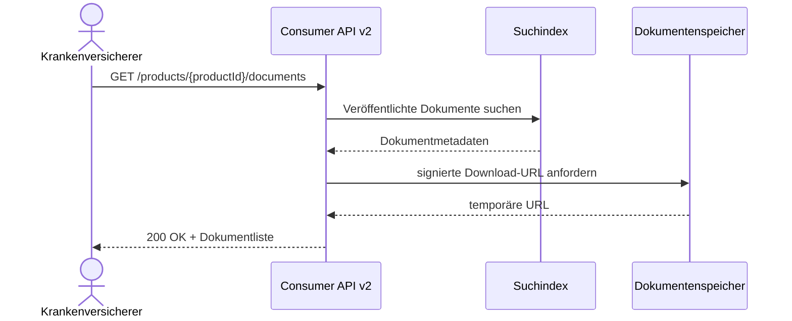

# eCAPI

Die eCAPI stellt elektronische Produktinformationen bereit.

## Verfügbare Versionen

| Version | Status |
|----------|----------|
| v1 | Note active |
| v2 | Active |

## Dokumentation

- [Version 1](v1/)
- [Version 2](v2/)
- [Release Notes](release-notes/)

## Funktionen

- Produktinformationen abrufen
- Suchfunktionen
- Metadaten bereitstellen

## OpenAPI

Die API wird über OpenAPI 3.0 beschrieben.

## Hinweise

- OpenAPI ist die technische Quelle (Source of Truth).
- Die interaktive API-Dokumentation wird automatisch generiert.
- Änderungen werden über Git versioniert und automatisiert veröffentlicht.