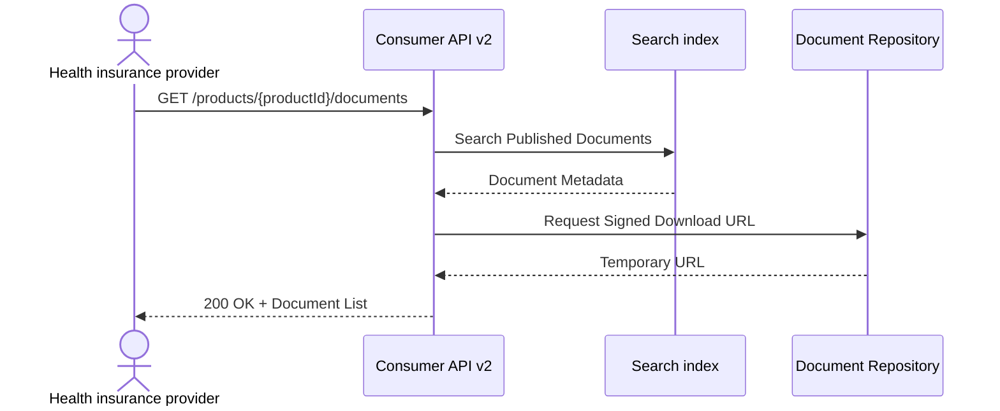
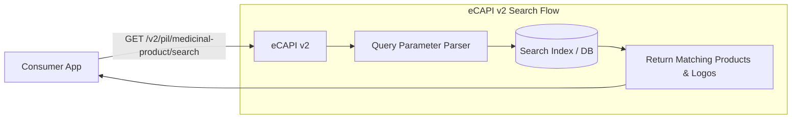

# eCAPI

The Electronic Consumer API (eCAPI) enables the search and retrieval of electronic product information within the EPL platform.

## Available Versions

| Version | Status |
|----------|----------|
| v1 | Active |
| v2 | Active |

## Documentation

- [Version 1](v1/)
- [Version 2](v2/) (recommended)
- [Release Notes](release-notes/)

## Functions

- Retrieve product information
- Provide search capabilities
- Provide product metadata


### eCAPI v2 Document Retrieval Flow



This sequence diagram illustrates how a healthcare stakeholder retrieves product-related documents using the **eCAPI v2** service.

The process begins when a health insurance provider sends a request to the Consumer API to retrieve documents for a specific product. The API searches the published document metadata in the search index and identifies the available documents. For each document, the API requests a signed download URL from the document repository. The repository returns a temporary access URL that allows secure document download without exposing the underlying storage system. Finally, the API responds to the consumer with a list of available documents and their corresponding download links.

#### Key characteristics:

- Secure document retrieval through temporary signed URLs
- Separation of search and storage responsibilities
- Metadata-driven document discovery
- Scalable architecture using dedicated search and repository services

### eCAPI v2 Product Search Flow



This component flow diagram illustrates the internal processing of a medicinal product search request within eCAPI v2.

A consumer application submits a search request to the endpoint:

```http
GET /v2/pil/medicinal-product/search
```

The request is received by the eCAPI v2 service, which forwards the search criteria to a query parameter parser. The parser validates and transforms the request parameters before executing the search against the search index or database. The search service then identifies all matching products and associated information. The results are returned to the consumer application in a structured format.

#### Key characteristics:

- Centralized search endpoint
- Query validation and normalization
- Efficient product lookup through a search index
- Fast retrieval of matching products and related metadata
- Support for consumer-facing search functionality

### Architectural Relationship

The two diagrams represent complementary capabilities of **eCAPI v2**:

- The **Product Search Flow** enables users to discover medicinal products through search functionality.
- The **Document Retrieval Flow** enables users to access detailed product information and associated documents after a product has been identified.

Together, they illustrate the end-to-end consumer journey from product discovery to document access within the Electronic Product Leaflet (EPL) platform.

## OpenAPI

API is documented using the OpenAPI 3.0 specification.

## Notes

- The OpenAPI specification serves as the authoritative source of truth for the API.
- Interactive API documentation is automatically generated from the OpenAPI definition.
- All changes are version-controlled in Git and automatically published through automated deployment processes.
- eCAPI v2 should be adopted as the preferred integration interface for all new developments. Existing eCAPI v1 consumers should plan a controlled migration to eCAPI v2 to benefit from improved search functionality, expanded metadata capabilities, and a more future-proof API architecture while maintaining compatibility with existing product information retrieval processes.


## Migration Recommendation: Migrating from eCAPI v1 to eCAPI v2

Organizations currently using eCAPI v1 are strongly encouraged to migrate to eCAPI v2 in order to benefit from enhanced search capabilities, additional metadata services, and a modernized API design. The migration effort is expected to be low, as the core functionality for retrieving electronic product information remains largely compatible between both versions.

## Benefits of Migrating to eCAPI v2
Improved product search capabilities through dedicated medicinal product search endpoints.
Access to additional metadata services, including company logo information.
Simplified version discovery endpoints.
Improved extensibility for future enhancements.
Continued support for existing product information retrieval scenarios.
Recommended Migration Approach
### 1. Review Current Integrations

Identify all existing eCAPI v1 endpoints currently used by your applications, particularly search-related functionality.

### 2. Update Search Endpoints

Replace legacy search endpoints:

```http
GET /v1/pil/search
```

with the new v2 endpoint:

```http
GET /v2/pil/medicinal-product/search
```

Applications should be tested to verify that expected search results are returned.

### 3. Update Version Discovery

Replace version-specific endpoints:

```http
/v1/version
/v1/api-versions
```

with:

```http
/version
/api-versions
```

to align with the new API structure.

### 4. Validate Core Retrieval Functions

Existing retrieval scenarios based on identifiers such as:

- PZN
- Business ID
- External ID

should be verified during testing, although these functions remain largely compatible between v1 and v2.

### 5. Adopt New Features

Where applicable, applications should be enhanced to leverage new metadata capabilities available in eCAPI v2, such as:

```http
GET /v2/company/logos
```

This functionality is not available in eCAPI v1.

## Migration Risk Assessment

| Area | Migration Impact |
|--------|------------------|
| Product Retrieval | Low |
| Identifier-Based Lookup | Low |
| Search Functionality | Medium |
| Metadata Services | Optional Enhancement |
| Authentication | No Significant Changes |