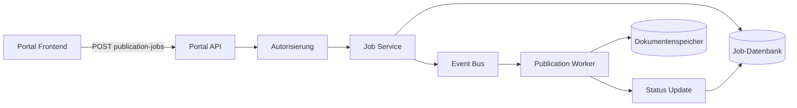

Funktionen des Portals. Die fachlichen Inhalte sind Platzhalter und müssen gegen die freigegebene Produktdokumentation geprüft werden.

## Dokumentation

- Dokumentation wurde noch nicht erstellt
  

