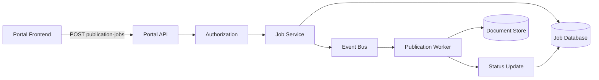

The Portal API (PAPI) provides portal-specific and administrative functionality for managing Electronic Product Leaflet (EPL) content and related platform operations.

**Note:**
The business-related content on this page is currently placeholder information and must be validated against the officially approved product documentation.

## Documentation

Documentation has not yet been created.

## Purpose

The Portal API is used by the EPL Portal frontend and supporting backend services to execute portal-specific operations that are not exposed through the external consumer or author APIs.

Potential use cases include:

- Publication management
- Administrative workflows
- Job execution and monitoring
- Content lifecycle management
- Status tracking and reporting

## Architecture Overview

The following diagram illustrates a possible publication workflow using the Portal API.

## Components

### Portal Frontend

User-facing application for operating and administering the EPL platform.

### Portal API

Backend API that exposes portal-specific functionality and orchestrates administrative processes.

### Authorization Service

Validates permissions and ensures that only authorized users can perform administrative actions.

### Job Service

Processes publication requests and coordinates background tasks.

### Event Bus

Enables asynchronous communication between platform components.

### Publication Worker

Executes publication-related tasks and updates document content.

### Document Store

Stores published content and associated document metadata.

### Job Database

Persists job definitions, processing status, audit information, and execution history.

## Future Documentation

The following sections will be added as part of the complete PAPI documentation:

- Overview
- Authentication and Authorization
- OpenAPI Specification
- Swagger UI
- Administrative Workflows
- Publication Management
- Release Notes
- Changelog
- Error Handling
- Architecture Details
``