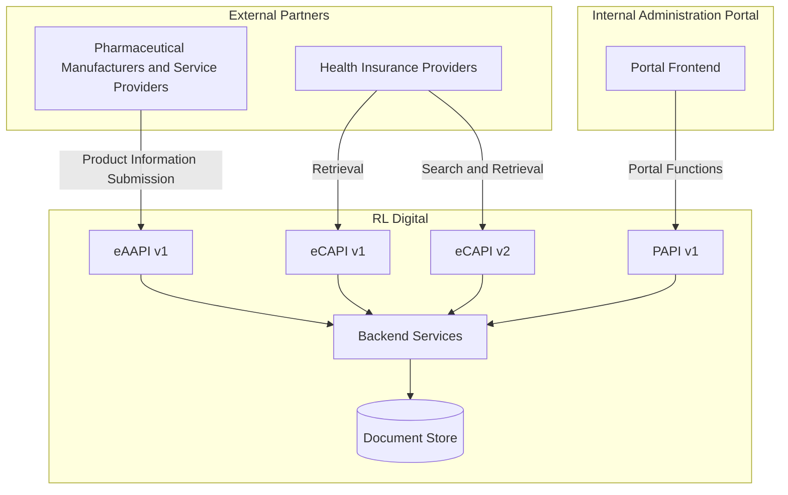

# Welcome to the Electronic Product Leaflet (EPL) API Documentation

## About the EPL Project

The Electronic Product Leaflet (EPL) Project is an industry-wide initiative aimed at digitizing pharmaceutical product information and replacing traditional paper package leaflets with secure digital alternatives.

The project was launched by leading German pharmaceutical industry associations, including BPI, Pharma Deutschland, Pro Generika, and vfa, with the objective of improving patient access to up-to-date medicinal product information while supporting the digital transformation of healthcare.

The EPL platform provides a standardized ecosystem for the creation, management, publication, and retrieval of electronic product information (ePI). Through a set of dedicated APIs, pharmaceutical companies, service providers, and digital healthcare applications can exchange product information in a consistent and interoperable manner.

The platform is operated by PharmaProtect Solutions GmbH (PPS) on behalf of the German pharmaceutical industry and leverages established healthcare interoperability standards to ensure data quality, security, and regulatory compliance.

### Key Objectives
Digitize pharmaceutical product information and package leaflets.
Improve patient access to current and accurate information.
Establish a standardized platform for electronic product information (ePI).
Enable seamless integration through standardized APIs.
Support regulatory compliance and interoperability within the healthcare ecosystem.

## Available APIs

👉 [To APIs](/rl-digital-api-docs/apis/)

### eAAPI (Electronic Author API)
 Enables the creation, submission, and maintenance of electronic product information.

👉 [eAAPI](/rl-digital-api-docs/apis/eaapi/)

### eCAPI (Electronic Consumer API)
 Provides access to published product information for consumer and third-party applications.

 
👉 [eCAPI](/rl-digital-api-docs/apis/ecapi/)

### PAPI (Portal API)
 Supports administrative and portal-related functions within the EPL ecosystem.

👉 [Zur PAPI](/rl-digital-api-docs/apis/papi)

## API and Documentation Architecture

The diagram illustrates the overall architecture of the Electronic Product Leaflet (EPL) platform and shows how different stakeholders interact with the available APIs and backend services.

External partners, consisting of pharmaceutical manufacturers, service providers, and health insurance providers, access the platform through dedicated APIs. Pharmaceutical manufacturers and their service providers submit product information via the Electronic Author API (eAAPI v1). Health insurance providers retrieve electronic product leaflet data through the Electronic Consumer API (eCAPI), which is available in both v1 and v2 versions.

Internal users access the system through the administration portal. The portal frontend communicates with the backend via the Portal API (PAPI v1), which provides administrative and portal-specific functionality.

All APIs are connected to a shared set of backend services that implement the business logic of the platform. These backend services act as the central integration layer for data submission, retrieval, search operations, and administrative functions.

The backend services persist and retrieve data from the central Document Store, which serves as the authoritative repository for electronic product leaflet content and related metadata.

This architecture clearly separates the different consumer groups and their use cases while ensuring that all interactions are processed through a common backend and data storage layer. The separation of eAAPI, eCAPI, and PAPI enables independent evolution of external and internal interfaces while maintaining a consistent underlying platform.

## Further Information

- [Glossary](/rl-digital-api-docs/concepts/glossary) 

---

# Internal: RL Digital API Documentation

Evaluierung von Hugo + Docsy im Rahmen von DIGIT-2604 zur Neustrukturierung der internen und externen API-Dokumentation.

## Bewertete Funktionen

- OpenAPI-basierte API-Dokumentation
- Technische und fachliche Dokumentation aus einer Quelle
- Mermaid-Diagramme
- Versionierung und Release Notes
- Volltextsuche
- Automatisierte Bereitstellung
- Git-basierte Zusammenarbeit

## 

## PoC-Ergebnis

| Kriterium | Status |
|-----------|---------|
| Hugo Evaluation | ✅ |
| Docsy Evaluation | ✅ |
| OpenAPI Integration | ✅ |
| Mermaid Integration | ✅ |
| Versionskonzept | ✅ |
| Suchfunktion | ✅ |
| Hosting | ✅ |
| CI/CD | ✅ |

## Nächste Schritte

1. Versionierung fertigstellen
2. OpenAPI-Automatisierung integrieren
3. GitHub Actions vervollständigen
4. Hosting-Konzept dokumentieren
5. Architekturentscheidung für DIGIT-2604 vorbereiten

## Known Bugs
1. Sidebar ist nicht auf allen Seiten
2. rl-digital-api-docs/apis/ contains unwanted generated content

## Navigation

Home
- Overview
- Getting Started
- Architecture

APIs
- eAAPI
  - Overview
  - Getting Started
  - API Reference
  - Integration Guide
  - Release Notes
  - Changelog
│
- eCAPI
  - Overview
  - Getting Started
  - API Reference
    - v2
    - v1
  - Migration Guide
  - Release Notes
  - Changelog

- PAPI
  - Overview
  - Architecture
  - API Reference
  - Release Notes
  - Changelog

- Shared Documentation
  - Architecture
  - Security
  - Versioning
  - Release Notes
  - Changelog
  - Developer Resources

- Support
  - FAQ
  - Troubleshooting
  - Contact
- ---

# Evaluation der Site https://wolfgang61.github.io/rl-digital-api-docs/ (DIGIT-2604)

Die Prüfung der Dokumentationsseite [wolfgang61.github.io/rl-digital-api-docs/](https://wolfgang61.github.io/rl-digital-api-docs/) im Hinblick auf das Ticket **DIGIT-2604** (Evaluierung von Hugo + Docsy zur Neustrukturierung der API-Dokumentation) ergibt folgendes Bild:

---

### 1. Hintergrund & Zielsetzung laut Website
Der genannte Prototyp dient der **Evaluierung von Hugo und dem Docsy-Theme** zur Neustrukturierung der internen und externen API-Dokumentation für das *Electronic Product Leaflet (EPL)*-Projekt (RL Digital).

---

### 2. Bewertete Funktionen & PoC-Ergebnisse
Im internen Bereich der Startseite sind die Evaluationskriterien und deren aktueller Status wie folgt dokumentiert:

* **Hugo Evaluation:** ✅ (Erfolgreich bewertet)
* **Docsy Evaluation:** ✅ (Erfolgreich bewertet)
* **OpenAPI Integration:** ✅ (Erfolgreich integriert)
* **Mermaid Integration:** ✅ (Unterstützung für Architektur-Diagramme gegeben, wie im Hauptteil zu sehen)
* **Versionskonzept:** ✅ (Vorhanden, z. B. bei eCAPI v1/v2)
* **Suchfunktion (Volltextsuche):** ✅ (Implementiert)
* **Hosting & CI/CD:** ✅ (Über GitHub Actions auf GitHub Pages bereitgestellt)
* **Git-basierte Zusammenarbeit:** ✅ (Gegeben durch den Tech-Stack)

---

### 3. Technische Architektur des PoC
* **Quellen:** OpenAPI-Spezifikationen, Markdown-Dateien und Mermaid-Diagramme.
* **Build-Pipeline:** Hugo in Kombination mit dem Docsy-Theme.
* **Deployment:** Automatisierter Workflow über **GitHub Actions** (`GH`) auf das Dokumentationsportal (`WS`).

---

### 4. Aktuelle Mängel / Known Bugs
* **Sidebar:** Ein bekannter Bug ist dokumentiert: *„Sidebar ist nicht auf allen Seiten“* (muss im Rahmen des Layout-Tunings für Docsy noch behoben werden).

---

### 5. Nächste Schritte laut Dokumentation
1. Versionierung finalisieren
2. OpenAPI-Automatisierung tiefer integrieren
3. GitHub Actions Pipelines vervollständigen
4. Hosting-Konzept dokumentieren
5. **Architekturentscheidung für DIGIT-2604 vorbereiten**

---

### Fazit
Der Proof of Concept (PoC) im Rahmen von **DIGIT-2604** ist weit fortgeschritten und zeigt eine funktionierende, automatisierte Toolchain (Hugo/Docsy/GitHub Actions) für das EPL-API-Dokumentationsportal. Abgesehen von kleineren UI-Mängeln (wie der Sidebar) sind alle Kernanforderungen erfolgreich evaluiert.
